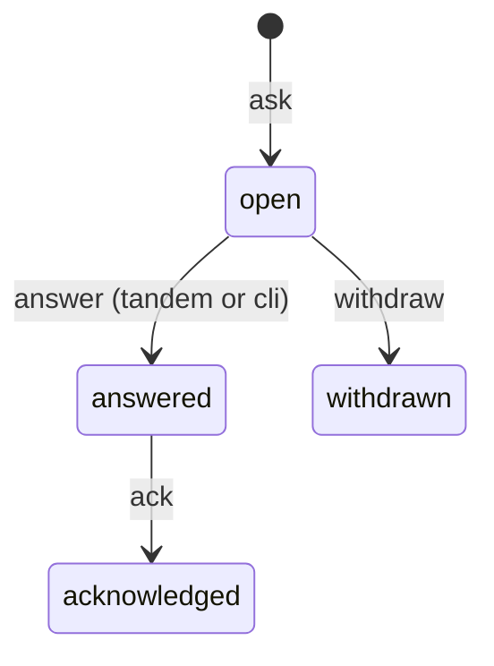

# Coordination Protocol

Root: `$TANDEM_COORD_DIR`, else `<main worktree>/.agent-workspace/coordination/` (found by walking up for `.agent-workspace/manifest.json` from `git rev-parse --git-common-dir`, so worktrees share one store). Directories are `0700`, files `0600`, and a `.gitignore` containing `*` is written at the root. Symlinked store directories are refused.

## Identifiers

| Field | Pattern |
|---|---|
| session id | `[a-z0-9-]{1,64}` |
| phase | `p-\d{3}-[a-z0-9-]{1,48}` |
| task | `t-\d{3}` |
| query id | `q-[a-z0-9]{4,32}` |

Text fields are capped at 8000 characters and stripped of control characters and escape sequences.

## Files

- `sessions/<id>.json`: `id, cli, role (planner|implementer), model, pane, cwd, branch, worktree, task, started, heartbeat`
- `claims/<phase>--<task>.json`: `phase, task, session, branch, worktree, paths[], claimed, heartbeat`. Created with an exclusive hard link, so exactly one claimant wins.
- `queries/<id>.md`: frontmatter only; every value is a JSON scalar or array on one line, so question and answer text can never inject fields: `id, status, asked_by, task, blocking_scope, created, question, options[], answer, answered_via (tandem|cli), answered_at`

Writes are temp file plus `os.replace`; query transitions also hold an exclusive lock. Reads are lock-free and tolerate malformed files.

## Query states

Only `open` queries accept an answer; a later answer fails with exit `1` and never overwrites.

## Staleness

A session or claim is `stale` when its heartbeat is older than 600 seconds. Stale claims are reported, never auto-released.
