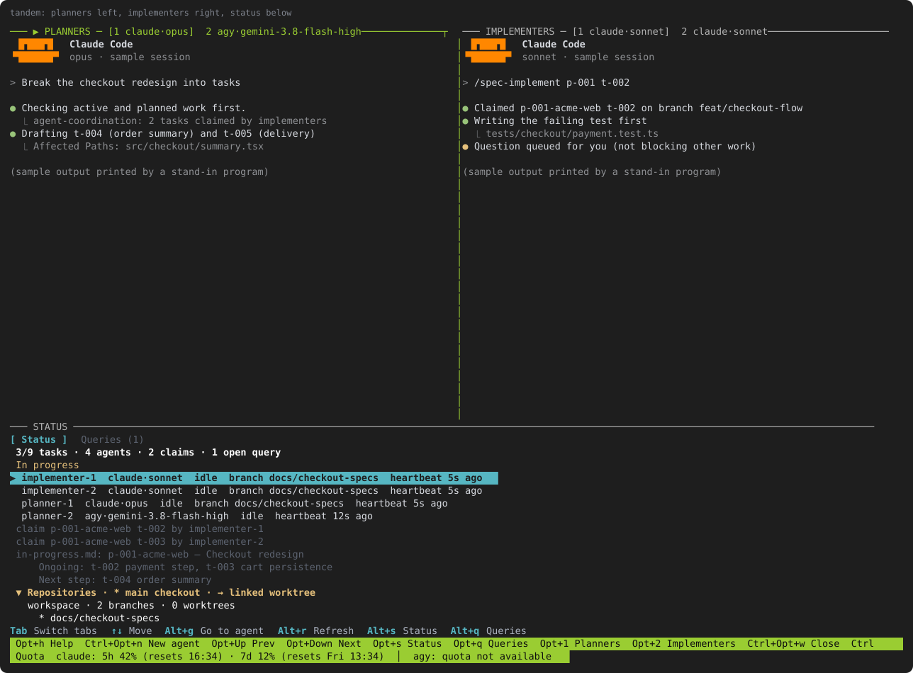
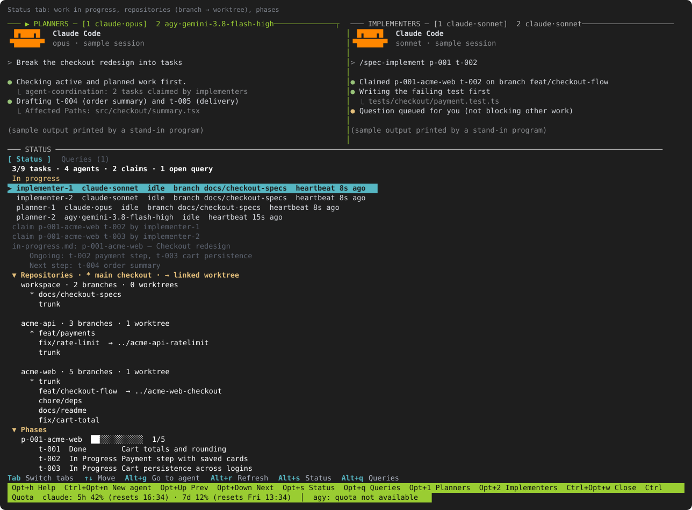
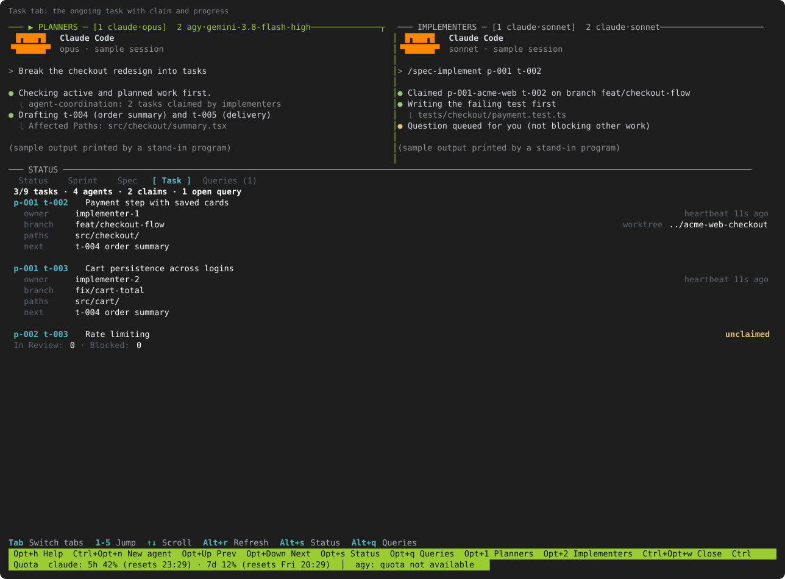
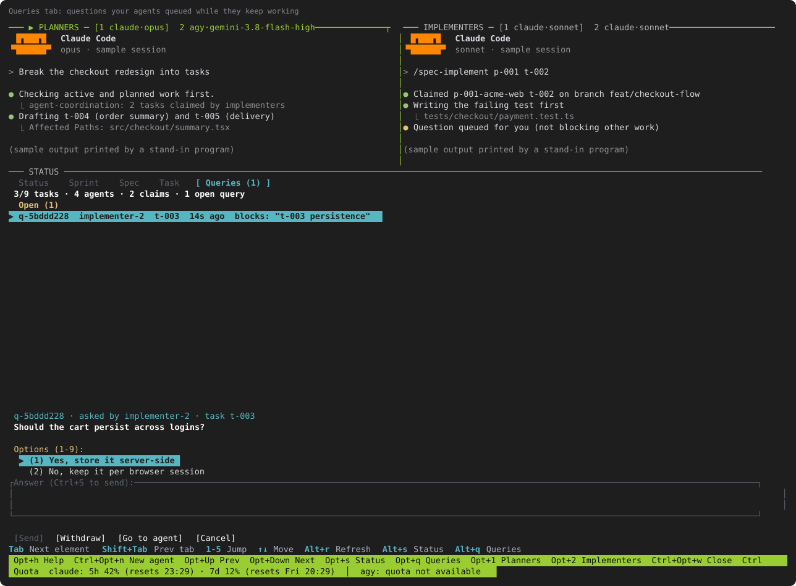
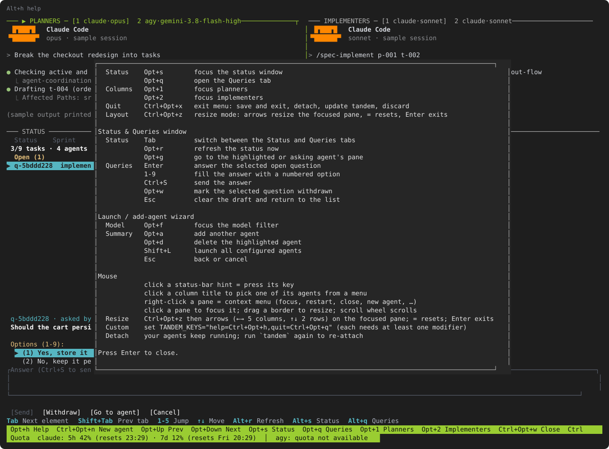

# tandem (agent-workspace)

**tandem** is the product, also known as **agent-workspace**. It turns any project directory into an AI-ready workspace — pre-loaded with specialized agents, reusable skills, and shared guidelines, configured for whichever AI provider you use.

> **Naming:** the command is `agent-workspace` (`npx hydrokat/agent-workspace init`), and `./run.sh` starts the tandem runtime that runs your AI CLIs side by side. There is no separate `tandem` command to install from npm.

## What it does

When you work with AI coding assistants (Claude Code, Antigravity CLI, Codex, opencode), each conversation starts cold. The assistant has no knowledge of your team's standards, no understanding of what each role should do, and no shared guidelines to follow. You end up re-explaining the same things repeatedly.

`agent-workspace` solves that by giving you a structured directory that your AI provider reads automatically:

- **Agent definitions** — named roles (`tech-lead-orchestrator`, `senior-backend-dev`, `qa-engineer`, etc.) with clear responsibilities, delegation rules, and the right model pre-assigned per provider
- **Reusable skills** — step-by-step instructions the AI follows for recurring tasks (workspace init, knowledge management, spec planning with repo-scoped `p-###` phases, `t-###` tasks, and UI mockups for frontend work, spec implementation with caveman-mode execution and strict code-comment discipline, pull requests, code review, `/workspace-cleanup` to find and remove files that don't belong in the workspace, `/symlink` to link another codebase into `codebase-symlinks/`, and the read-and-explain commands `/spec-explain`, `/explain`, `/feasibility`, and `/code-cleanup` — see [Slash commands](#slash-commands-for-your-ai))
- **Shared guidelines** — architecture standards, security rules, and best practices the AI respects across every conversation, including branch protection (agents never commit directly to `main`, `master`, or `trunk` unless explicitly told to, and use a worktree or a new branch before implementing) and concurrent agent awareness (agents check for other agents' in-progress work before starting instead of assuming exclusive access)
- **Live progress tracking** — `specs/in-progress.md` lists every task or spec an agent is actively working on, its next step, the owning spec (or `adhoc` if it has none), and the explicitly assigned agent and worktree to prevent collision, so you always know what's in flight; entries are removed as soon as the task completes
- **Provider outputs** — each provider gets its own compatibility format (`.claude/`, `.gemini/`) auto-generated from a single source of truth

Run one command. Get a workspace that works with Claude, Antigravity, Codex, or opencode out of the box.

## Quick start

No installation. Run directly with `npx`:

```bash
cd your-project-agent-workspace
npx hydrokat/agent-workspace init
```

The CLI will ask for your project name, which providers to configure, and whether to link any sibling codebases. Answer the prompts and you're done.

To skip prompts (CI or scripted setup):

```bash
npx hydrokat/agent-workspace init --yes --providers claude --name "my-project"
```

## Commands

### `init` — set up a new workspace

Run this once in a project directory that doesn't have a workspace yet.

```bash
npx hydrokat/agent-workspace init
```

What it does:
1. Asks for project name, providers, and whether to link sibling codebases
2. Creates the directory structure (`knowledgebase/`, `specs/`, `.agents/`)
3. Installs all agents, skills, and guidelines
4. Generates provider-specific outputs for each selected provider
5. Runs `doctor` to verify everything is correct
6. Writes `.agent-workspace/manifest.json` to remember your setup

**If the directory already has a workspace**, init will warn you and suggest running `update` instead.

Example — set up for Claude and Codex, non-interactively:

```bash
npx hydrokat/agent-workspace init --yes --providers claude,codex --name "payments-api"
```

Set up for opencode (v2, `@opencode/cli`) next to Claude:

```bash
npx hydrokat/agent-workspace init --yes --providers claude,opencode --name "payments-api"
```

---

### `update` — pull in the latest content

Run this when you want to get new or updated agents, skills, or guidelines from the package.

```bash
npx hydrokat/agent-workspace update
```

What it does:
- Refreshes all managed files (agents, skills, and the guideline documents in `knowledgebase/guidelines/`) with the latest shipped versions
- Removes stale skills, files inside skill directories, and stale agents across all providers (`.agents/skills`, `.claude/skills`, and legacy `.gemini/skills`) while preserving `.bak` backups
- Adds any knowledgebase note or README that is missing, but never overwrites one that already exists: notes like `context-history/key-decisions.md` and `best-practices/*.md` are yours once created
- If you edited a managed file locally, it backs it up to `<file>.bak` before overwriting
- Refreshes the model table and operating principles in `AGENTS.md` (the managed block between `<!-- managed:start -->` and `<!-- managed:end -->`)
- Fully regenerates provider outputs, fixing any manual drift
- Offers to update your AI CLIs (see below)
- **Never touches** your project content: `specs/`, `knowledgebase/business-flows/`, or any knowledgebase entries you wrote yourself

`update` reads your saved manifest so it remembers which providers you configured — no re-prompting required.

#### Updating your AI CLIs

After the workspace files are updated, `update` looks at the AI CLIs this workspace uses: `claude`, `agy` (Antigravity), and `codex` or `opencode` when they are configured providers, plus `claude` and `agy` always, because tandem launches them. Only CLIs already on your `PATH` are considered; `update` never installs one and never uses `sudo`.

```
▶ AI CLIs
  claude  2.1.305  native   latest unknown → claude update
  codex   0.52.0   npm      0.54.1 available → npm install -g @openai/codex@latest
Check and apply these updates? [y/N]
  ✔ claude  2.1.305 → 2.1.310
  ✖ codex   update failed (exit 1) — run it yourself: npm install -g @openai/codex@latest
```

- Each CLI is updated with its own documented command (`claude update`, `agy update`, and for codex `npm install -g @openai/codex@latest` or `brew upgrade --cask codex`; for opencode `npm install -g @opencode/cli@latest` or `brew upgrade anomalyco/tap/opencode-v2`). Where a CLI has no documented command that is safe to run, for example codex or opencode installed with their install scripts, `update` prints the command for you to run. It never pipes a download into a shell.
- Where a read-only check exists (npm, Homebrew), a CLI that is already current is left out. `claude` and `agy` have no check-only mode, so they are listed as "latest unknown" and their updater decides.
- **Consent:** one question, default No. `--update-clis` or `--yes` applies without asking; `--no-update-clis` skips (and wins over `--yes`); `--dry-run` only lists. With no terminal and no flag, it prints one line saying how to apply and does nothing. Set `AGENT_WORKSPACE_INTERACTIVE=1` to answer from piped input.
- `DISABLE_UPDATES=1` is respected for claude: it is skipped with a note.
- A failed or timed-out (5 minutes) CLI update never fails `update`; it is reported with the command to run yourself. A CLI still below tandem's minimum version gets a warning.
- `--json` adds an `aiClis` record with the results. The step runs last, so a slow CLI update cannot leave the workspace half-updated.

---

### Git handling in `init` and `update`

- `init` checks whether the folder is a git repository. If it isn't (and isn't inside another repo), it asks whether to create a **blank local repo**; link a remote yourself later with `git remote add origin <url>`.
- `update` records which files it changes and, if the workspace is its own repo, asks whether to **commit just those files** (`chore: update agent-workspace to <version>`). Your other uncommitted edits and `.bak` backups are never included, and a protected branch (`main`, `master`, `trunk`) is called out in the question.
- `--yes` never creates a repo or commits by itself; pass `--git` / `--commit` for that. Both default to **No**.
- Private tandem state (`tandem-session.json`, coordination files) is git-ignored via `.agent-workspace/.gitignore`.
- When the workspace is a git repo, the spec-planner's delivery task also delivers the workspace itself (specs, knowledgebase), on a non-protected branch; with no remote it commits and asks you how to integrate.

### `doctor` — verify the workspace

Run this any time you want to confirm the workspace is in a valid state.

```bash
npx hydrokat/agent-workspace doctor
```

What it checks:
- Required directories and `AGENTS.md` exist
- All template skills are present and no stale skill directories (or legacy `.gemini/skills`) exist
- Every agent has a generated output file for each configured provider
- Generated agents have valid frontmatter (`name`, `description`, `model`)
- Each agent's `model:` value matches the expected model for that provider
- Compatibility symlinks (`CLAUDE.md`, `GEMINI.md`) are correct
- Codebase symlinks resolve

Exits with code `0` if everything passes, non-zero if anything fails — useful in CI.

```bash
# Machine-readable output for CI pipelines
npx hydrokat/agent-workspace doctor --json
```

### `web` — remote multi-workspace web interface

Start, stop, or check the status of the remote mobile/tablet web interface (`tandem-web`):

```bash
# Launch tandem with remote web enabled
./run.sh --web

# Or manage the daemon directly
npx hydrokat/agent-workspace web
npx hydrokat/agent-workspace web --status   # prints the URL and a QR code to scan with your phone
npx hydrokat/agent-workspace web --stop
npx hydrokat/agent-workspace web --list-ips
```

**First use installs it.** `./run.sh --web` and `web` set up `tandem-web` the first time they run, and skip every step that is already done:
- If your workspace has no `tandem-web` folder (the normal case after `init`), the bundled source is copied once into `~/.local/state/tandem/tandem-web` (or `$XDG_STATE_HOME/tandem/tandem-web`), stamped with the package version. It is replaced automatically after an upgrade. Nothing is written into your workspace.
- Dependencies are installed (`bun install --frozen-lockfile`) and the dashboard is built (`bun run build`) only when missing.
- **Dependency check.** Before enabling, tandem checks that `bun` is installed *and runs on this host* (`bun --version`), looking on `PATH`, `$BUN_INSTALL/bin` and `~/.bun/bin`. If `terminal attach` is on it also notes whether `ttyd` is installed (optional, never blocks).
- **If something is missing, you choose.** tandem asks whether it should install it or whether you will. *Let tandem install* generates a script for your platform from the [official bun guide](https://bun.com/docs/installation), saves it as `install-web-deps.sh` (or `.ps1`) in the state directory, shows its path, runs it, then re-checks that bun works before enabling. *I'll install it myself* keeps the script for review and prints the exact commands. The script never uses `sudo`.
  - macOS and Linux: `curl -fsSL https://bun.com/install | bash` (Linux needs `unzip`; macOS 13+; x64 CPUs need SSE4.2). Windows: `powershell -c "irm bun.sh/install.ps1|iex"`.
  - Missing prerequisites (`curl`, `unzip`) and unsupported platforms are explained with the right command for your package manager instead of offering an install that cannot work.
  - `ttyd` is installed automatically only on macOS with Homebrew; elsewhere you get the command.
  - Flags: `--yes` installs without asking; `--no-install-deps` never installs and prints how to; with no terminal and no `--yes` nothing is installed.
- Without a local `bin/agent-workspace.js`, `./run.sh --web` runs `npx --yes <TANDEM_UPDATE_SPEC or hydrokat/agent-workspace> web`, so Node.js is required. If `npx` is missing you get a message saying so instead of a silent no-op.
- Enabling web from the tandem **Web** tab shows a first-time prompt that says additional dependencies (bun, tandem-web packages, ttyd) may be installed. If tandem-web is not installed or built yet, the tab shows the command to run (`agent-workspace web`).

What it does:
1. Launches the responsive `tandem-web` dashboard on your chosen VPN or localhost IP address
2. Lets you monitor multiple running `tandem` workspaces from phone or browser
3. Provides live status, sprint, spec, and task tracking over Server-Sent Events (SSE)
4. Lets you answer agent queries (`coord.py ask`) with one-tap quick-option chips or custom text
5. Optionally attaches to the workspace's live `tmux` session via `ttyd` with touch modifier buttons
6. Maintains a strict 100% ToS air-gap: zero keystroke injection or scraping into AI agent panes

**File browser:** `tandem-web` exposes read-only file browsing, text preview (up to 256 KiB), and attachment download for registered workspaces and directories linked directly under `codebase-symlinks/`. Symlinks or paths resolving outside those roots are refused, and a built-in deny list blocks common secret paths (such as `.git`, `.ssh`, `.env`, private keys, and credential files). The deny list is a convenience guard, not a substitute for keeping secrets out of a directory you expose over a network.

---

## Flags

| Flag | Commands | Description |
|---|---|---|
| `--yes` | `init`, `update` | Skip all prompts and accept defaults |
| `--providers <list>` | `init`, `update` | Comma-separated: `claude`, `antigravity`, `codex`, `opencode` |
| `--name <name>` | `init` | Set the project name without prompting |
| `--no-link` | `init` | Skip sibling codebase linking |
| `--link-all` | `init` | Link all sibling codebases without prompting |
| `--git` / `--no-git` | `init` | Create (or skip) a blank local git repo without asking |
| `--commit` / `--no-commit` | `update` | Commit (or skip committing) the files the update changed without asking |
| `--update-clis` / `--no-update-clis` | `update` | Update (or skip updating) the installed AI CLIs without asking |
| `--bind <ip>` | `web` | Bind IP address for tandem-web (VPN or localhost) |
| `--port <port>` | `web` | Port for tandem-web (default: 3940) |
| `--status` | `web` | Check running state of tandem-web daemon |
| `--stop` | `web` | Stop tandem-web daemon |
| `--no-qr` | `web` | Do not print the connect QR code |
| `--no-install-deps` | `web` | Never install bun or other dependencies; print how to install them |
| `--list-ips` | `web` | List detected host network IPs and source interfaces |
| `--dry-run` | `init`, `update` | Show what would change without writing anything |
| `--quiet` | all | Suppress per-file output; show only summaries |
| `--verbose` | all | Show all actions, including unchanged files |
| `--json` | all | Emit structured JSON output (one record per line) |
| `--version` | — | Print the package version |
| `--help` | — | Print usage |

---

## What gets created

After running `init`, your project directory will contain:

```
your-project-agent-workspace/
├── AGENTS.md                          # Workspace rules (edit the overview; the rest is managed)
├── WORKFLOW.md                        # Shared execution style for all agents
├── .agent-workspace/
│   └── manifest.json                  # Tracks providers, version, managed files
├── .agents/
│   ├── agents/
│   │   ├── tech-lead-orchestrator/
│   │   ├── project-manager/
│   │   ├── senior-backend-dev/
│   │   ├── frontend-dev/
│   │   ├── qa-engineer/
│   │   ├── security-auditor/
│   │   └── ...                        # 18 agents total
│   └── skills/
│       ├── spec-planner/
│       ├── pm-new-sprint/
│       ├── pm-sprint-implement/
│       ├── ui-ux-pro-max/
│       ├── marketing-plan/
│       ├── workspace-init/
│       ├── workspace-sync/
│       └── ...                        # includes pricing, offers, social, sales-enablement
├── .claude/                           # Generated — do not edit manually
│   ├── agents/                        # Claude-compatible agent files (model injected)
│   └── skills/
├── .gemini/                           # Generated — do not edit manually (if configured)
│   └── agents/
├── knowledgebase/
│   ├── guidelines/                    # Architecture, security, testing standards
│   ├── best-practices/                # Operating principles
│   ├── business-flows/                # Your project-specific flows (never touched by update)
│   └── context-history/
├── sprints/                           # 1-week sprints (s-###-<slug>/ with sprint.md, BRD, FRD, FSD)
│   └── README.md
├── specs/                             # Your implementation plans (never touched by update)
│   └── in-progress.md                 # Live list of active tasks/specs, per-task next steps
└── .tmp/                              # Agent working files — safe to delete anytime
```

---

## Providers

Each provider gets its own format generated from the same source agents:

| Provider | Where agents live | Workspace doc | Skills location | Model behavior |
|---|---|---|---|---|
| **Claude** | `.claude/agents/*.md` | `CLAUDE.md` → symlink to `AGENTS.md` | `.claude/skills/` | `tools:` field removed; `model:` injected |
| **Antigravity** | `.gemini/agents/*.md` | `GEMINI.md` → symlink to `AGENTS.md` | `.agents/skills/` (shared) | `tools: ["*"]` added; `model:` injected |
| **Codex** | `.agents/agents/*/AGENT.md` | `AGENTS.md` (native) | `.agents/skills/` (shared) | `model:` injected in place |
| **opencode** | `.opencode/agents/*.md` | `AGENTS.md` (native, no link created) | `.agents/skills/` (shared) | `tools:` removed; `mode: subagent` and `model: provider/model` set |

The correct model is automatically assigned per agent per provider — for example, `tech-lead-orchestrator` gets `claude-opus-4-7` for Claude, `gemini-2.5-pro` for Antigravity, `gpt-5.5` for Codex, and `anthropic/claude-opus-4-7` for opencode (the opencode defaults mirror the Claude models under the `anthropic/` provider; run `opencode models` to see what is available to you).

Antigravity and opencode read skills from `.agents/skills/` directly (the canonical source), so no separate skills directory is created for them.

`.opencode/` also holds your own opencode content (custom agents, skills, `opencode.json`, plugins). `update` only replaces or prunes the agent files it generated itself and never touches anything else there.

---

## Editing your workspace

### Things you should edit

- **`AGENTS.md`** — set your project name, system architecture, and directory overview in the section above `<!-- managed:start -->`. The block between the managed markers is refreshed on every `update`; content outside it is yours.
- **`WORKFLOW.md`** — customize the shared execution style for your team.
- **`knowledgebase/business-flows/`** — add process flows, decision paths, and operational context specific to your project.
- **`knowledgebase/context-history/`** — record important architectural decisions or major changes.
- **`specs/`** — create implementation plans and task breakdowns here.

### Things you should not edit manually

- **`.claude/`** and **`.gemini/`** — these are fully regenerated on every `update`. Any manual edits will be overwritten (with a `.bak` backup). (`.gemini/` is the agent output directory for Antigravity.)
- **`.opencode/agents/<agent>.md`** files that `update` generated are rewritten the same way (with a `.bak` backup). Your own agents, skills, `opencode.json`, and plugins in `.opencode/` are never touched.
- **`.agents/agents/`** and **`.agents/skills/`** — these are managed library files. If you edit them locally, `update` will back them up and restore the shipped version.

If you want to add a custom agent or skill that won't be overwritten, the right place is a separate directory outside `.agents/` (e.g., `my-agents/`), then reference it from your `AGENTS.md`.

---

## Slash commands for your AI

Skills in `.agents/skills/` are triggered by name in Claude Code, Antigravity, Codex, and opencode.

| Command | What it does |
|---|---|
| `/pm-new-sprint` | Plan a 1-week sprint with RICE + MoSCoW prioritization, capacity check, and HTML stakeholder docs (BRD, FRD, FSD) |
| `/pm-sprint-explain [sprint]` | Explain sprint value, business goals, scope, and MoSCoW deliverables in plain language |
| `/pm-sprint-lock [sprint]` | Lock sprint scope to prevent ad-hoc additions; freeze commitments |
| `/pm-sprint-unlock [sprint]` | Unlock a locked sprint with user confirmation and logged rationale |
| `/pm-sprint-close [sprint]` | Close completed sprint, evaluate deliverables, and handle carry-over |
| `/pm-sprint-implement [sprint]` | Implement sprint phases in MoSCoW order with multi-agent collision prevention and wave isolation |
| `/pm-sprint-status [sprint]` | Live sprint dashboard with active agent claims, deliverables, and sequential/parallel ETAs |
| `/pm-sprint-list` | List all historical, active, and planned sprints |
| `/pm-commands` | Catalog of all PM and sprint management commands |
| `/pm-backlogs [specs|tasks|all] [sprint]` | Scan unscheduled backlog specs and tasks, folding chosen items or task subsets into active sprint or planning next sprint |
| `/spec-plan` | Plan a phase: branches, scope, tasks with Affected Paths and Depends On, sprint sizing (splits oversized work into `/pm-new-sprint`), and delivery task |
| `/spec-implement [phase] [task]` | Implement a phase or active sprint task: queries `sprints.py next-work` by default, plans parallel waves, claims tasks, keeps progress in sync, runs `/code-cleanup --diff` |
| `/spec-compile [all\|completed\|incomplete\|NNN\|NNN-NNN]` | Compile completed and incomplete specs into `specs/compiled/`; preserves archived phases from guarded phase pruning |
| `/spec-explain [phase]` | Explain a phase: what it fixes, what it develops, why, where, and its state |
| `/explain <module or feature> [--non-technical]` | Explain how part of the codebase works, technically by default or in plain language |
| `/feasibility <feature>` | Decide whether a feature can be built here and how: verdict, effort, options, risks, unknowns |
| `/idea <idea> [--auto]` | Assess feasibility with `/feasibility --save`, gate on the verdict, and plan a phase with `/spec-planner` |
| `/code-cleanup [paths] [--diff <base>]` | List unnecessary comments, ask which to delete, then delete only those |
| `/cleanup-tests [paths]` | Audit, clean up, and strengthen tests: remove dead or redundant tests, fill missing coverage, verify security and data-isolation paths, run the suite |
| `/workspace-cleanup` | List files that may not belong in the workspace and delete the ones you approve |
| `/symlink [path] [--name <name>]` | Link a directory into `codebase-symlinks/` and refresh the codebase map; with no path, lists sibling directories to choose from |
| `test-failures` (used automatically) | Agents run tests through `run_tests.py`, so only the failing tests reach their context; the full log is saved under `.agent-workspace/test-runs/` |

`/spec-explain`, `/explain`, and `/feasibility` never change files unless you ask them to save. `/code-cleanup`, `/workspace-cleanup`, and guarded phase pruning (`specs.py prune`) delete nothing without your explicit answer. `/idea --auto` runs unattended without asking questions, applies documented defaults recorded in `impl.md`, and ends with one `idea_result` JSON line.

### Script-first skills

Repetitive steps run as small Python 3 scripts (standard library only) that print JSON, so the AI keeps only the judgment work. Run them with `python3`, for example `python3 .agents/skills/spec-planner/scripts/specs.py list`. If a script is missing or fails, the skill says so and falls back to the manual steps. Skills that scaffold files render templates from their `assets/` folder.

---

## tandem: run several AI CLIs side by side

`init` and `update` install `./run.sh` in your workspace (the tandem project goes under `.agent-workspace/tandem/`). `./run.sh` launches **tandem**: your `claude`, `agy`, and (optionally) `opencode` sessions in one tmux window, an agent sidebar on the left, a responsive multi-agent grid in the main area, and a 6-tab status window below.

```bash
./run.sh            # check dependencies, ask before installing/updating, then launch
./run.sh --factory  # start tandem in Factory Mode (experimental: ideas board & tandem factory CLI)
./run.sh --fresh    # end a running tandem session, clear .agent-workspace/coordination/, discard the saved session and start fresh
./run.sh --check    # report only; change nothing
./run.sh --yes      # answer yes to every prompt (--no answers no)
./run.sh --no-update  # skip the launch-time update check this time
./run.sh --fetch-runtime  # pre-fetch and verify binary runtime non-interactively
```

### Factory Mode (experimental)

Factory Mode is an opt-in operating mode that takes a feature or fix **from idea to pull request, with a human at the right gate**. An Orchestrator works with you to scope the idea, check feasibility, and draft a plan before any code is written. Once you approve the plan and open the required gates, tandem runs the delivery stages in an isolated git worktree and hands back a GitHub pull request with test and review evidence.

#### Login choice & provider terms

Factory Mode workers run interactively in tmux panes (`claude`, `agy`, `opencode`) using **whatever login each CLI already holds on your machine** (`tandem` reads no secrets and handles no credentials). Before choosing how to sign in:

- **Subscription vs. API key**: Using a consumer subscription in an orchestrator-driven workflow may conflict with provider terms of service. Review the 2026-11-20 terms verdicts in [`factory-provider-terms.md`](../../knowledgebase/architecture-decisions/factory-provider-terms.md):
  - `claude`: API key / Claude Console commercial terms are `allowed-with-conditions`; consumer subscription automation is `not-allowed` (gray area for local end-user workflows).
  - `agy`: Google AI Studio API key / Vertex AI / Gemini Enterprise are `allowed-with-conditions`; consumer OAuth wrapping is `unclear` and excluded from headless automation.
  - `opencode`: uses whichever provider/API-key configuration you set inside opencode.
- **API-key sign-in**: To sign in with an API key instead, open **Settings → Agents & sign-in** (in TUI or `tandem-web`) or run `tandem factory login open <cli>`, which opens the CLI's own sign-in screen in an isolated tmux pane.

#### Before you start

Make sure these four prerequisites are in place before starting a run:

1. **A Factory Mode session**: Launch with `./run.sh --factory` (or `tandem --factory`). Normal and Factory Mode sessions cannot share the same workspace at the same time.
2. **At least one signed-in AI CLI**: Verify `claude`, `agy`, or `opencode` is installed and signed in via **Settings → Agents & sign-in** or `tandem factory login status --json` (and `tandem factory login open <cli>`).
3. **`gh` authenticated by you**: Run `gh auth login` on your machine so tandem can open a pull request on GitHub using your existing CLI session.
4. **Confirmed check commands**: Inspect proposed `test` and `lint` commands with `tandem factory checks discover` and confirm them as the user with `tandem factory checks set --target <name> --test "<cmd>" --lint "<cmd>" --confirm <name>`.

#### Walkthrough: from idea to pull request

Using the example idea *"Export team activity as CSV for the last 90 days"*:

1. **Start an idea**: Open the **Factory** tab (`Alt+f` / `Opt+f`, or in `tandem-web`) and create an idea, picking the Orchestrator CLI (`claude`, `agy`, or `opencode`) and model, or run `tandem factory idea start --cli claude --model opus --title "Export team activity as CSV for the last 90 days"`. You see a bound Orchestrator pane open for the idea.
2. **Talk to the Orchestrator**: Describe the idea directly in the Orchestrator pane. The Orchestrator uses `factory-orchestrator` (and `/idea` for feasibility + planning) to record a feasibility study (`artifact put --kind feasibility`), log assumptions (`idea assume`), and advance past Gate 1 (`idea select-direction`) once feasibility is non-infeasible.
3. **Answer decision-relevant questions**: Open questions tagged `idea:<id>` surface on the ideas board (`Needs you` / `Blockers`) and are answered in the **Queries** tab or `tandem-web` Queries inbox. You decide any scope or product trade-offs before planning finishes.
4. **Review and mark `ready-for-development` (Gate 2)**: Inspect the feasibility study, versioned plan, and assumptions in the **Factory** detail view (TUI or `tandem-web`). Only the user can mark an idea ready (`tandem factory idea ready <id> --confirm <id> [--workflow NAME] [--deploy]` or the UI confirmation dialog), which freezes `plan-snapshot.md` with its SHA-256 hash and creates a **queued** run (`runs/<run-id>/workflow.yaml` + `run.json`). During the `approval_grace_secs` undo window, you can undo via the banner, or withdraw a queued run (`tandem factory run withdraw <run-id> --confirm <run-id>`) and revoke `ready-for-development` (`tandem factory idea revoke-ready <id>`) before any stage starts.
5. **Dry-run a workflow & assign stage models (optional)**: Preview what a workflow would do with `tandem factory run simulate --workflow default-delivery`. Optionally override any stage's CLI or model in **Run Monitor → Assignments** (`a` in TUI or Assignment Editor in `tandem-web`) or via `tandem factory agent assign --run <run-id> --stage <stage> --cli <cli> --model <model> --by user`; user assignments always override the Orchestrator's choices. When neither chose, the default is the cheapest capable model among your signed-in CLIs (`tandem factory models recommend --run <run-id> --stage <stage> [--complexity low|medium|high]`), and the team view shows the tier, cost basis, and number of candidates.
6. **Confirm check commands**: Before `create-tests`/`develop`/`test` run, confirm `test` / `lint` commands (`tandem factory checks set --target <name> --test "<cmd>" --lint "<cmd>" --confirm <name>`).
7. **Run through the interactive team & quality path to PR**: When the run starts, tandem prepares an isolated git worktree (`worktrees/factory-<run-id>` on `feat/<idea-id>-<slug>` — use `tandem factory run target <run-id> <repo>` if multiple repos exist) and launches an interactive tmux worker pane per stage. Monitor workers in the **Run Monitor Team** panel (`[v]iew`, `[m]essage`, `[s]top`, `[relaunch]`; interactive cost displays `cost: not tracked`):
   - `plan`: decomposes work into `slices.json` and slice task files.
   - `create-tests`: writes failing tests for the CSV export acceptance criteria inside the slice paths.
   - `develop`: implements the CSV export while preserving the tests from `create-tests`.
   - `test`: tandem itself executes your confirmed test and lint commands directly (not an agent) and records pass/fail evidence.
   - `review`: reviews the diff against the plan and runs bounded fix rounds (up to `max_review_rounds`) if blocker/major findings are raised.
   - `demo` (conditional): runs when `ui_changed` is set, capturing local PNG screenshots for UI acceptance criteria.
   - **Pull request & handoff**: once review approves and required evidence is complete, tandem pushes the feature branch and opens **one pull request per run** on GitHub via `gh`, then hands off the PR link, evidence summary (`tandem factory run evidence <run-id>`), and `tandem factory run prs <run-id>` status to you for review and merge. Clean up the worktree afterward with `tandem factory run cleanup <run-id> --confirm <run-id>`.

#### The three gates

| Gate | What it authorizes | Who can pass it | How to undo |
|---|---|---|---|
| **Gate 1** | Ideation → Planning (after a non-infeasible `feasibility` artifact is recorded). | Orchestrator or user (`tandem factory idea select-direction <id>`). | Record updated feasibility/plan artifacts or close/re-describe the idea before Gate 2. |
| **Gate 2** | Planning → `ready-for-development`; freezes `plan-snapshot.md` (SHA-256) and queues a run. | **User-only** (`tandem factory idea ready <id> --confirm <id>`, TUI, or `tandem-web`). | Undo during the `approval_grace_secs` window (TUI `Ctrl+Opt+u` / Web `[Undo]`), or run `tandem factory run withdraw <run-id> --confirm <run-id>` and `tandem factory idea revoke-ready <id>` before any stage starts. |
| **Gate 3** | Protected actions (`production_deploy`, `secrets_access`, `production_access`); 1-hour TTL bound to run, stage, and `workflow_sha256`. | **User-only** (`tandem factory run approve <run-id> --action <ACTION> --confirm <run-id> [--stage <STAGE>]`). | Do not approve, or pause/cancel the run (`tandem factory run pause <run-id> --now` / `tandem factory run cancel <run-id> --confirm <run-id>`); deploy also requires `--deploy`, a PR, and a confirmed deploy command. |

#### When a run pauses

| Pause reason | Command or screen that resolves it |
|---|---|
| Multiple target repositories found | `tandem factory run target <run-id> <repo>` (then `tandem factory run resume <run-id>`) |
| CLI not signed in or missing | Open **Settings → Agents & sign-in** (or run `tandem factory login open <cli>`), sign in, then `tandem factory run resume <run-id>` |
| Test and lint commands not confirmed | `tandem factory checks set --target <name> --test "<cmd>" --lint "<cmd>" --confirm <name>`, then `tandem factory run resume <run-id>` |
| Checks fail on the base branch | Fix the base branch checks outside the run (or update check commands), then `tandem factory run resume <run-id>` |
| Stage failed without a new hypothesis, or retries exhausted | `tandem factory run retry <run-id> <stage> --hypothesis "<what changed>"` (or `tandem factory run cancel <run-id> --confirm <run-id>`) |
| Budget cap reached (`max_cost_usd`, `max_duration_secs`, `max_retries`) | Raise the cap with `tandem factory run budget <run-id> ...` and `tandem factory run resume <run-id>`, or `tandem factory run cancel <run-id> --confirm <run-id>` |
| Tool permission denied or Gate 3 approval required | `tandem factory permissions allow ...` or `tandem factory run approve <run-id> --action <ACTION> --confirm <run-id>`, then `tandem factory run resume <run-id>` |
| Review loop exhausted (`max_review_rounds`) | Inspect findings (`tandem factory run show <run-id> --json`), resolve manually or raise `max_review_rounds`, then resume or cancel |
| PR creation or deploy precondition failed (`gh` auth, clean worktree, remote, or missing PR/deploy cmd) | Resolve the precondition shown in `action_commands` (`gh auth login`, `checks set --deploy`, `run prs --refresh`), then `tandem factory run resume <run-id>` |
| User-requested pause or interrupted job after restart | `tandem factory run resume <run-id>` (or run `tandem factory doctor --fix` if state needs recovery) |

#### Settings and workflows

- **Where they live**: Workspace settings live in `.agent-workspace/factory/settings.json` (managed via `tandem factory settings get|set`, `provider`, `checks`, and `permissions`). Workflows live in `<workspace>/workflows/*.yaml` (`init` installs `default-delivery.yaml`, which is user-owned; if deleted, tandem falls back to the embedded default).
- **What you can change**: Non-protected settings (`max_parallel_agents`, `default_temperature`, `max_review_rounds`, `approval_grace_secs`, `default_workflow`, `default_budget`, `model_tiers`, `price_table`) can be changed by the user via `tandem factory settings set <KEY> <VALUE>`. Protected keys (`provider_gates`, `providers`, `checks`, `deploy`, `deploy_command`, `allowed_tools`, `denied_tools`) require their dedicated user-only commands.
- **Workflows can only tighten**: A workflow's `policy` and stage budgets cannot relax `settings.json` bounds—tandem enforces the stricter (`min`) of workflow policy and workspace settings.

#### Troubleshooting

- **Mode mismatch (`exit 2`)**: Normal and Factory Mode cannot run in the same workspace simultaneously. Quit the active session (`Settings → Quit`) before switching between `./run.sh` and `./run.sh --factory`.
- **CLI not signed in**: Run `tandem factory login status --json` or open **Settings → Agents & sign-in** to launch the CLI's native sign-in pane (`claude auth login`, `opencode auth login`, or sign in from `agy`'s own TUI), then resume the run.
- **`gh` not authenticated**: Run `gh auth login` in your terminal and verify `gh auth status` succeeds before resuming the run.
- **Check commands missing**: Run `tandem factory checks discover` to inspect detected commands, then confirm them with `tandem factory checks set --target <name> --test "<cmd>" --lint "<cmd>" --confirm <name>`.
- **Checks failing on the base branch**: The `test` stage checks the base branch before running work so pre-existing failures are not blamed on the run. Fix the base branch first, then `tandem factory run resume <run-id>`.
- **Budget pause**: Run `tandem factory run usage <run-id>` to see what hit the limit, then either raise caps with `tandem factory run budget <run-id>` and `run resume`, or `run cancel`.
- **Policy denial**: Check `tandem factory permissions show` and the run's `action_commands` (`tandem factory run show <run-id> --json`) to see whether a tool is denied for the target/agent or needs Gate 3 `run approve`.
- **Unsupported host**: Check `tandem/README.md` for supported platforms (`linux-x86_64`, `linux-arm64`, `darwin-arm64`, `darwin-x86_64`, and experimental `windows-x86_64` under MSYS2/WSL); on unsupported hosts, use `TANDEM_RUNTIME=source` with Rust/Cargo installed.
- **Screenshot tool missing (`demo` stage)**: If `ui_changed` is set and the `demo` stage cannot capture PNG screenshots (e.g. Playwright/browser not installed), install the project's screenshot tool or review the `demo` stage log (`tandem factory run log <run-id> <job>`) before resuming.
- **Recovery with `factory doctor`**: If a run or session was interrupted mid-flight (stale runner lock, interrupted job state, or workspace mismatch), run `tandem factory doctor` to diagnose and `tandem factory doctor --fix` to repair safely.

#### Governance

##### What stays yours

> **Governance stance:** Factory Mode accelerates execution; it does not transfer accountability. Teams keep approval, merge, deployment, and compliance responsibility.

Review, merge, deployment, and compliance remain yours: tandem never approves or merges pull requests, never force pushes or pushes to protected branches, and never deploys without explicit Gate 3 approval.

##### What Factory Mode does not do

The six non-goals from the Factory Mode proposal:

1. **No autonomous production deployment by default** (`deploy` is gated behind `--deploy`, a PR, a confirmed deploy command, and Gate 3 `run approve`).
2. **No unrestricted provider execution** (headless stages require an open, consented provider gate and tool allowlists).
3. **No cross-project portfolio optimization** (each Factory Mode run is scoped to one workspace and one target repository).
4. **No self-modifying workflows** (agents cannot edit `workflows/*.yaml`, `.github/workflows/`, `.agent-workspace/`, or `settings.json`).
5. **No fully automatic merge** (tandem opens a PR and hands it off; humans review and merge).
6. **No IDE replacement** (tandem orchestrates CLIs, worktrees, and checks alongside your editor).

##### Known limits

- **Approval boundary & threat model**: The user-only approval boundary (`approval::require_user`: terminal `IsTerminal` check, tmux `@tandem_role` check, derived surface with `--via` removed, `approval_grace_secs` undo window, and audit log) is a guard-rail and audit trail against accidental or prompt-injected agent actions, not a sandbox—it does not stop a deliberately hostile process running as the **same OS user** (which requires OS isolation). See `tandem/README.md` for all five measures, limits, and exit codes.
- **Process termination**: Jobs are stopped with a kill after a grace period and their own child processes may survive.
- **Cost visibility**: Cost is `unknown` unless the provider reports usage or a `price_table` entry exists; `max_cost_usd` is not enforceable for providers that report no usage.
- **Local-only artifacts**: `demo` screenshots and raw local logs (`log.txt`) stay local on the machine and are not uploaded or rewritten by redaction.
- **PR scope & host**: Factory Mode opens at most **one pull request per run** and supports **GitHub only** (`gh`).

##### Your data

- **What tandem sends**: Inspect what each job explicitly sent (`sent_files` in `context_manifest` and byte counts) with `tandem factory run data <run-id>`.
- **What a job can read**: A provider CLI running in the worktree can read any file in the readable target/worktree scope; tandem does not see which files the provider CLI read beyond `context_manifest`.
- **Default exclusions**: `.env*`, `*.pem`, `*.key`, `id_rsa*`, `secrets/**`, and `.git/**` are excluded from `context_manifest` by default. Redaction (`tandem factory redact test <file>`) masks secrets in exported artifacts and audit summaries.

**Governance (`p-018`) & Quality Path (`p-017`) reference:** See `tandem/README.md` for the full CLI reference (`settings get|set`, `run budget`, `run usage`, `run approve`, `run data`, `redact test`, `permissions allow|deny|show`, `audit`, `audit verify`, `checks discover|set|show`, `run evidence`, `run prs`, `run export-specs`, `factory doctor`), stage contracts, and exit codes.

**Auto-update on launch.** Before checking dependencies, `run.sh` checks whether a newer agent-workspace release exists. When one is found, it applies the update (`npx --yes hydrokat/agent-workspace update --yes --no-link --no-update-clis --no-commit`), prints the old → new version and what changed, then re-execs the updated `run.sh`. If the workspace has no `manifest.json` (a dev checkout), if `npx` is not on `PATH`, or if the update fails, launch continues with the installed version.

| Environment variable | Default | Description |
|---|---|---|
| `TANDEM_AUTO_UPDATE` | `1` | Set to `0` to disable the launch-time update check permanently. |
| `TANDEM_UPDATE_SPEC` | `hydrokat/agent-workspace` | npm package spec to update from; set to `owner/repo` or `owner/repo#ref` when running from a fork. |
| `TANDEM_RUNTIME` | `auto` | Runtime mode: `auto` (binary first, then build from source with cargo), `binary` (strict binary, exit 4 on failure), or `source` (skip the binary and build with cargo). |
| `TANDEM_RELEASE_BASE` | `https://github.com/hydrokat/agent-workspace/releases/download` | Base download URL for release binaries and checksums. |

The version check waits at most 15 seconds, so an offline or slow network delays launch by that long at worst; set `TANDEM_AUTO_UPDATE=0` to skip it entirely. Pass `--no-update` for a single-launch opt-out. `--check` reports an available update without applying it. See `tandem/README.md` for the in-session update check that runs while tandem is open.

### Runtime: native binary and source fallback

tandem is a native Rust binary, so it starts instantly. `./run.sh` fetches and verifies the binary for your platform from GitHub Releases. If the binary is unavailable (offline, checksum mismatch, blocked by Gatekeeper or `noexec`, or no prebuilt binary for your platform), `run.sh` offers to build tandem on your machine from the shipped sources with `cargo build --release --locked`. It never compiles without your yes (`--yes` answers it for you); declining exits with code 2, and non-interactive runs without `--yes` exit with code 6.

**Supported platforms:**
- `linux-x86_64` and `linux-arm64` (static musl binaries; no glibc requirement)
- `darwin-arm64` and `darwin-x86_64` (macOS 13+)
- `windows-x86_64` (experimental support under MSYS2 / Git Bash with tmux, or the Linux binary inside WSL)

**Binary cache & verification:**
Binaries are verified against `SHA256SUMS` and cached under `${XDG_STATE_HOME:-~/.local/state}/tandem/bin/<version>-<platform>/` with the active version pointed to by `tandem/bin/current`. Stale versions are pruned. Source builds go to `${XDG_STATE_HOME:-~/.local/state}/tandem/build-<workspace>/`, outside the package directory.

**Flags and variables:**
- `./run.sh --fetch-runtime`: pre-fetches and verifies the binary non-interactively without launching tandem (exit 0 on success, exit 4 on failure).
- `TANDEM_RUNTIME=auto|binary|source`:
  - `auto` (default): tries the binary first; builds from source if it is unavailable.
  - `binary`: requires the binary; fails with exit code 4 if unavailable or the checksum fails.
  - `source`: skips the binary and builds with cargo.
- `TANDEM_RELEASE_BASE`: base URL for binary release archives and `SHA256SUMS`.

`run.sh` needs `git`, `tmux`, at least one of `claude` / `agy` / `opencode` (it offers to install `claude` and `agy` but never installs `opencode`; an installed opencode is only checked against `TANDEM_MIN_OPENCODE`, and an opencode below it is skipped with the update command to run, never a reason to stop), and, only when tandem has to be built from source, `cargo` (run.sh offers to install it through rustup). Rules:

- Missing dependency: asks to install it. Declining stops (exit 2), except that declining one AI CLI is fine while the other is installed.
- Installed but outdated (where a check exists): asks to update; declining continues with what you have.
- Installed but below tandem's minimum version (it may crash): asks again; declining stops (exit 3).
- Prompts default to **No**, show the exact command first, and never pipe an installer to a shell without showing its URL. `claude` and `agy` update themselves and have no check-only mode, so only the minimum-version gate applies to them.
- Exit codes: 0 ok, 2 declined install, 3 declined required update, 4 install/update/config failure, 5 unsupported platform, 6 needs a prompt but stdin is not a terminal.

macOS (Homebrew) is tested; Linux (apt, dnf) is covered by stubbed tests only.

<p align="center"></p>

The window shows the agent sidebar on the left, the agent grid in the main area, and the status window below. The status window features six tabs:
- **Status:** live agent sessions, active claims, repository branches and worktrees, and sprint progress summary.
- **Sprint:** the active 1-week sprint in full, tracking capacity vs committed days, task progress, days left, and phase progress in MoSCoW order.
- **Spec:** ongoing specification phases with their branch strategy, progress bar, task status ordered by task id with in-progress marker `▶`, and next-up labelling.
- **Task:** ongoing tasks with objective checklist progress, owning session and pane, heartbeat age, branch, worktree, claimed paths, and next step from `in-progress.md`. Press `Alt+g` to jump to the owning agent's tmux pane.
- **Queries:** non-blocking questions queued by your agents.
- **Web:** enable or disable `tandem-web` with first-time dependency consent, pick the bind IP and source, set the port, toggle the `ttyd` terminal, show or hide the auth token, regenerate it, and open a scannable QR code to connect a phone. Start errors are shown in the pane.
- **Settings:** UI layout preferences (grid columns, rows per page, fill order, sidebar mode) and interactive Reset UI.

Navigate between tabs with `Tab` / `Shift+Tab`, number keys `1-7`, or mouse click; scroll tab content with `↑↓`, `PgUp`/`PgDn`, `Home`/`End`, and the mouse wheel. Global shortcuts `Alt+s` (focus Status window), `Alt+q` (focus Queries tab), and `Alt+,` (focus Settings tab) remain available.

<p align="center">  </p>

<p align="center"></p>

<sub>The screenshots show a fictional demo project ("acme") with stand-in agents, rendered from a real tandem run. Regenerate them with `cargo build --release --manifest-path tandem/Cargo.toml && python3 docs/screenshots/make_screenshots.py` (needs tmux and python3); a test fails if a screenshot contains a home-directory path.</sub>

**Models** are asked at every launch (no hard-coded defaults). `claude` always runs with `--permission-mode auto`; `agy` runs with `--dangerously-skip-permissions` only if you answer **Yes** to the warning. `opencode` (v2) is optional: tandem offers it when it is on your `PATH`, lists models with `opencode models` (type an id such as `anthropic/claude-sonnet-5-5` if the list is empty), passes the model to opencode through its `OPENCODE_CONFIG_CONTENT` environment variable, and adds `--auto` only if you answer **Yes** to the same warning.

**Save and resume.** tandem autosaves the session (agents, models, folders, layout and each agent's conversation ID) while it runs. After a crash or a clean `Ctrl+Alt+x` → *Save state and exit*, the next `./run.sh` asks whether to resume, which reopens every agent's conversation through `claude --resume` / `agy --conversation`, or to start blank. See `tandem/README.md` → *Save, resume and update*. opencode agents do not resume yet: tandem always starts a fresh opencode session (its session-id handling is not verified), so a restart or resume loses that agent's conversation history inside tandem; use opencode's own `--continue` in a shell if you need it.

**Coordination.** The `agent-coordination` skill (`scripts/coord.py`) lets sessions register, claim spec tasks atomically, send heartbeats, and ask questions without blocking: an agent keeps working outside the blocked scope while the question waits in the **Queries** tab. Planners check running and planned work before planning; implementers claim before coding and use a worktree when another implementer is active. Without tandem, the same skill works from any CLI.

**Not included, on purpose:** a unified chat or prompt routing across CLIs. providers such as Google (Antigravity) restrict or do not support wrapping their CLI inside third-party applications on consumer plans, so tandem only spawns each CLI as you would yourself and never types into or reads its pane. See `tandem/README.md` for the keymap and layout.

## Sibling codebase linking

If you work across multiple repositories, `init` can create symlinks to sibling directories (projects at the same level in your filesystem) under `codebase-symlinks/`. It also generates a `codebase-map.md` that agents read before navigating between repos.

```bash
# Init will prompt: "Link sibling codebases? [y/N]"
npx hydrokat/agent-workspace init

# Or link all siblings automatically
npx hydrokat/agent-workspace init --link-all

# Or skip linking entirely
npx hydrokat/agent-workspace init --no-link
```

---

## Workflow for day-to-day use

```
1. init once          →  npx hydrokat/agent-workspace init
2. open your AI tool  →  Claude Code, Antigravity CLI (`agy`), Codex, opencode, etc.
3. agents are ready   →  the AI reads .claude/ or .gemini/ automatically
4. update when needed →  npx hydrokat/agent-workspace update
5. verify any time    →  npx hydrokat/agent-workspace doctor
```

---

## Contributing

1. Edit canonical files only: `AGENTS.md`, `.agents/agents/`, `.agents/skills/`, `templates/`.
2. Never manually edit generated files under `.gemini/` or `.claude/`. (`.gemini/` contains Antigravity agent files.)
3. After editing base files, run `npx . update` to regenerate outputs.
4. To add a new agent or skill, add it under `templates/agents/` or `templates/skills/` and update `src/data/models.json` with its model assignments.
5. Run `npm test` before submitting.

## License

MIT
