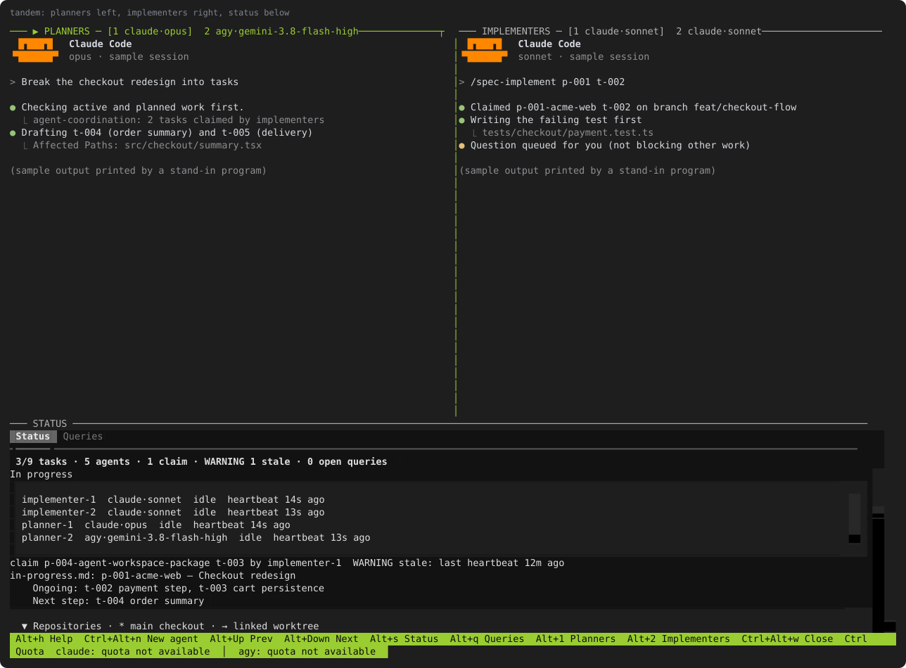
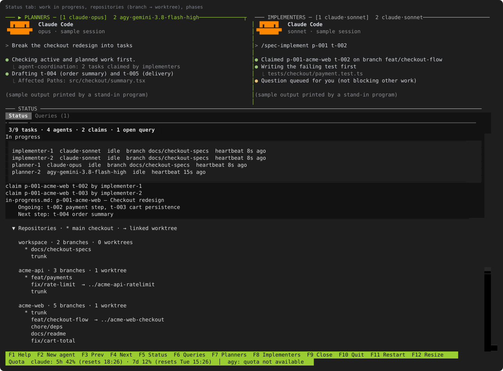
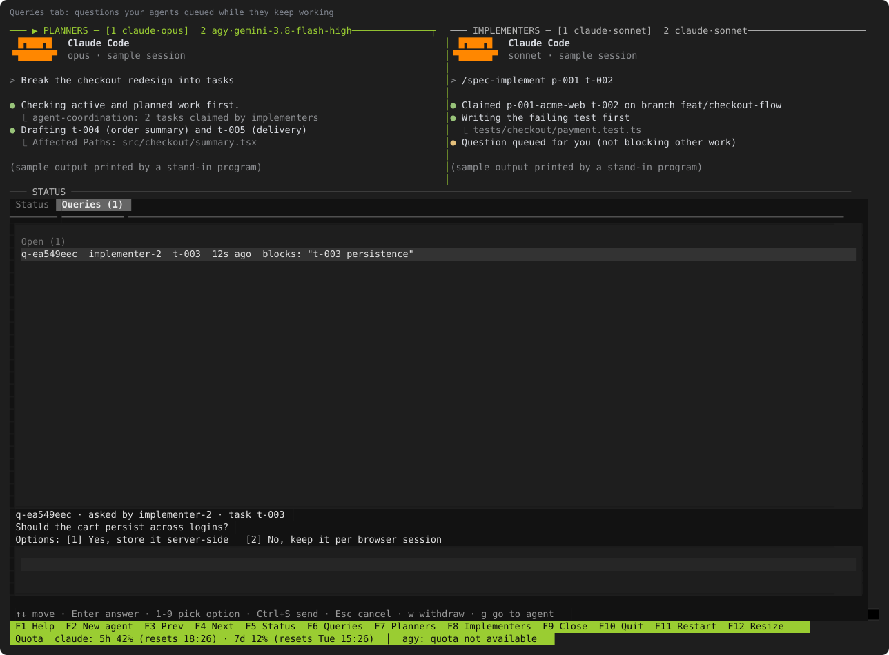
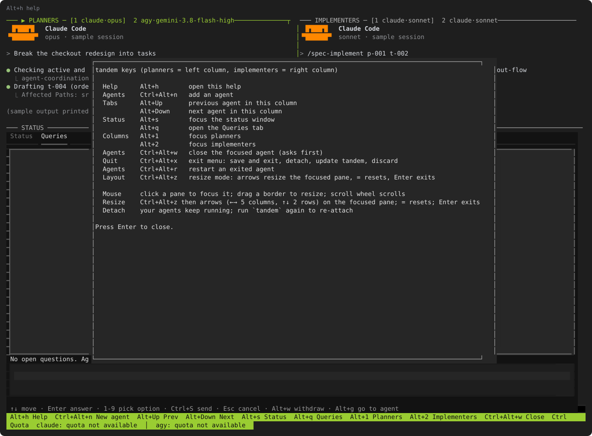

# agent-workspace

A CLI that turns any project directory into an AI-ready workspace — pre-loaded with specialized agents, reusable skills, and shared guidelines, configured for whichever AI provider you use.

## What it does

When you work with AI coding assistants (Claude Code, Antigravity CLI, Codex), each conversation starts cold. The assistant has no knowledge of your team's standards, no understanding of what each role should do, and no shared guidelines to follow. You end up re-explaining the same things repeatedly.

`agent-workspace` solves that by giving you a structured directory that your AI provider reads automatically:

- **Agent definitions** — named roles (`tech-lead-orchestrator`, `senior-backend-dev`, `qa-engineer`, etc.) with clear responsibilities, delegation rules, and the right model pre-assigned per provider
- **Reusable skills** — step-by-step instructions the AI follows for recurring tasks (workspace init, knowledge management, spec planning with repo-scoped `p-###` phases, `t-###` tasks, and UI mockups for frontend work, spec implementation with caveman-mode execution and strict code-comment discipline, pull requests, code review, `/workspace-cleanup` to find and remove files that don't belong in the workspace, and the read-and-explain commands `/spec-explain`, `/explain`, `/feasibility`, and `/code-cleanup` — see [Slash commands](#slash-commands-for-your-ai))
- **Shared guidelines** — architecture standards, security rules, and best practices the AI respects across every conversation, including branch protection (agents never commit directly to `main`, `master`, or `trunk` unless explicitly told to, and use a worktree or a new branch before implementing) and concurrent agent awareness (agents check for other agents' in-progress work before starting instead of assuming exclusive access)
- **Live progress tracking** — `specs/in-progress.md` lists every task or spec an agent is actively working on, its next step, the owning spec (or `adhoc` if it has none), and the explicitly assigned agent and worktree to prevent collision, so you always know what's in flight; entries are removed as soon as the task completes
- **Provider outputs** — each provider gets its own compatibility format (`.claude/`, `.gemini/`) auto-generated from a single source of truth

Run one command. Get a workspace that works with Claude, Antigravity, or Codex out of the box.

## Quick start

No installation. Run directly with `npx`:

```bash
cd your-project-agent-workspace
npx hydrokat/agent-workspace init
```

The CLI will ask for your project name, which providers to configure, and whether to link any sibling codebases. Answer the prompts and you're done.

To skip prompts (CI or scripted setup):

```bash
npx hydrokat/agent-workspace init --yes --providers claude --name "my-project"
```

## Commands

### `init` — set up a new workspace

Run this once in a project directory that doesn't have a workspace yet.

```bash
npx hydrokat/agent-workspace init
```

What it does:
1. Asks for project name, providers, and whether to link sibling codebases
2. Creates the directory structure (`knowledgebase/`, `specs/`, `.agents/`)
3. Installs all agents, skills, and guidelines
4. Generates provider-specific outputs for each selected provider
5. Runs `doctor` to verify everything is correct
6. Writes `.agent-workspace/manifest.json` to remember your setup

**If the directory already has a workspace**, init will warn you and suggest running `update` instead.

Example — set up for Claude and Codex, non-interactively:

```bash
npx hydrokat/agent-workspace init --yes --providers claude,codex --name "payments-api"
```

---

### `update` — pull in the latest content

Run this when you want to get new or updated agents, skills, or guidelines from the package.

```bash
npx hydrokat/agent-workspace update
```

What it does:
- Refreshes all managed files (agents, skills, guidelines) with the latest shipped versions
- If you edited a managed file locally, it backs it up to `<file>.bak` before overwriting
- Refreshes the model table and operating principles in `AGENTS.md` (the managed block between `<!-- managed:start -->` and `<!-- managed:end -->`)
- Fully regenerates provider outputs, fixing any manual drift
- **Never touches** your project content: `specs/`, `knowledgebase/business-flows/`, or any knowledgebase entries you wrote yourself

`update` reads your saved manifest so it remembers which providers you configured — no re-prompting required.

---

### Git handling in `init` and `update`

- `init` checks whether the folder is a git repository. If it isn't (and isn't inside another repo), it asks whether to create a **blank local repo**; link a remote yourself later with `git remote add origin <url>`.
- `update` records which files it changes and, if the workspace is its own repo, asks whether to **commit just those files** (`chore: update agent-workspace to <version>`). Your other uncommitted edits and `.bak` backups are never included, and a protected branch (`main`, `master`, `trunk`) is called out in the question.
- `--yes` never creates a repo or commits by itself; pass `--git` / `--commit` for that. Both default to **No**.
- Private tandem state (`tandem-session.json`, coordination files) is git-ignored via `.agent-workspace/.gitignore`.
- When the workspace is a git repo, the spec-planner's delivery task also delivers the workspace itself (specs, knowledgebase), on a non-protected branch; with no remote it commits and asks you how to integrate.

### `doctor` — verify the workspace

Run this any time you want to confirm the workspace is in a valid state.

```bash
npx hydrokat/agent-workspace doctor
```

What it checks:
- Required directories and `AGENTS.md` exist
- Every agent has a generated output file for each configured provider
- Generated agents have valid frontmatter (`name`, `description`, `model`)
- Each agent's `model:` value matches the expected model for that provider
- Compatibility symlinks (`CLAUDE.md`, `GEMINI.md`) are correct
- Codebase symlinks resolve

Exits with code `0` if everything passes, non-zero if anything fails — useful in CI.

```bash
# Machine-readable output for CI pipelines
npx hydrokat/agent-workspace doctor --json
```

---

## Flags

| Flag | Commands | Description |
|---|---|---|
| `--yes` | `init`, `update` | Skip all prompts and accept defaults |
| `--providers <list>` | `init`, `update` | Comma-separated: `claude`, `antigravity`, `codex` |
| `--name <name>` | `init` | Set the project name without prompting |
| `--no-link` | `init` | Skip sibling codebase linking |
| `--link-all` | `init` | Link all sibling codebases without prompting |
| `--git` / `--no-git` | `init` | Create (or skip) a blank local git repo without asking |
| `--commit` / `--no-commit` | `update` | Commit (or skip committing) the files the update changed without asking |
| `--dry-run` | `init`, `update` | Show what would change without writing anything |
| `--quiet` | all | Suppress per-file output; show only summaries |
| `--verbose` | all | Show all actions, including unchanged files |
| `--json` | all | Emit structured JSON output (one record per line) |
| `--version` | — | Print the package version |
| `--help` | — | Print usage |

---

## What gets created

After running `init`, your project directory will contain:

```
your-project-agent-workspace/
├── AGENTS.md                          # Workspace rules (edit the overview; the rest is managed)
├── WORKFLOW.md                        # Shared execution style for all agents
├── .agent-workspace/
│   └── manifest.json                  # Tracks providers, version, managed files
├── .agents/
│   ├── agents/
│   │   ├── tech-lead-orchestrator/
│   │   ├── senior-backend-dev/
│   │   ├── frontend-dev/
│   │   ├── qa-engineer/
│   │   ├── security-auditor/
│   │   └── ...                        # 12 agents total
│   └── skills/
│       ├── spec-planner/
│       ├── workspace-init/
│       ├── workspace-sync/
│       └── ...
├── .claude/                           # Generated — do not edit manually
│   ├── agents/                        # Claude-compatible agent files (model injected)
│   └── skills/
├── .gemini/                           # Generated — do not edit manually (if configured)
│   ├── agents/
│   └── skills/
├── knowledgebase/
│   ├── guidelines/                    # Architecture, security, testing standards
│   ├── best-practices/                # Operating principles
│   ├── business-flows/                # Your project-specific flows (never touched by update)
│   └── context-history/
├── specs/                             # Your implementation plans (never touched by update)
│   └── in-progress.md                 # Live list of active tasks/specs, per-task next steps
└── .tmp/                              # Agent working files — safe to delete anytime
```

---

## Providers

Each provider gets its own format generated from the same source agents:

| Provider | Where agents live | Workspace doc | Skills location | Model behavior |
|---|---|---|---|---|
| **Claude** | `.claude/agents/*.md` | `CLAUDE.md` → symlink to `AGENTS.md` | `.claude/skills/` | `tools:` field removed; `model:` injected |
| **Antigravity** | `.gemini/agents/*.md` | `GEMINI.md` → symlink to `AGENTS.md` | `.agents/skills/` (shared) | `tools: ["*"]` added; `model:` injected |
| **Codex** | `.agents/agents/*/AGENT.md` | `AGENTS.md` (native) | `.agents/skills/` (shared) | `model:` injected in place |

The correct model is automatically assigned per agent per provider — for example, `tech-lead-orchestrator` gets `claude-opus-4-7` for Claude, `gemini-2.5-pro` for Antigravity, and `gpt-5.5` for Codex.

Antigravity reads skills from `.agents/skills/` directly (the canonical source), so no separate skills directory is created for it.

---

## Editing your workspace

### Things you should edit

- **`AGENTS.md`** — set your project name, system architecture, and directory overview in the section above `<!-- managed:start -->`. The block between the managed markers is refreshed on every `update`; content outside it is yours.
- **`WORKFLOW.md`** — customize the shared execution style for your team.
- **`knowledgebase/business-flows/`** — add process flows, decision paths, and operational context specific to your project.
- **`knowledgebase/context-history/`** — record important architectural decisions or major changes.
- **`specs/`** — create implementation plans and task breakdowns here.

### Things you should not edit manually

- **`.claude/`** and **`.gemini/`** — these are fully regenerated on every `update`. Any manual edits will be overwritten (with a `.bak` backup). (`.gemini/` is the agent output directory for Antigravity.)
- **`.agents/agents/`** and **`.agents/skills/`** — these are managed library files. If you edit them locally, `update` will back them up and restore the shipped version.

If you want to add a custom agent or skill that won't be overwritten, the right place is a separate directory outside `.agents/` (e.g., `my-agents/`), then reference it from your `AGENTS.md`.

---

## Slash commands for your AI

Skills in `.agents/skills/` are triggered by name in Claude Code, Antigravity, and Codex.

| Command | What it does |
|---|---|
| `/spec-plan` | Plan a phase: branches, scope, tasks with Affected Paths and Depends On, a generated Parallel Waves section, and a final delivery task |
| `/spec-implement [phase] [task]` | Implement a phase: plans parallel waves, claims tasks, keeps `t-###.md` and `impl.md` in sync, runs `/code-cleanup --diff` before review |
| `/spec-compile [all\|completed\|incomplete\|NNN\|NNN-NNN]` | Compile completed and incomplete specs into `specs/compiled/` |
| `/spec-explain [phase]` | Explain a phase: what it fixes, what it develops, why, where, and its state |
| `/explain <module or feature> [--non-technical]` | Explain how part of the codebase works, technically by default or in plain language |
| `/feasibility <feature>` | Decide whether a feature can be built here and how: verdict, effort, options, risks, unknowns |
| `/code-cleanup [paths] [--diff <base>]` | List unnecessary comments, ask which to delete, then delete only those |
| `/workspace-cleanup` | List files that may not belong in the workspace and delete the ones you approve |

`/spec-explain`, `/explain`, and `/feasibility` never change files unless you ask them to save. `/code-cleanup` and `/workspace-cleanup` delete nothing without your explicit answer.

### Script-first skills

Repetitive steps run as small Python 3 scripts (standard library only) that print JSON, so the AI keeps only the judgment work. Run them with `python3`, for example `python3 .agents/skills/spec-planner/scripts/specs.py list`. If a script is missing or fails, the skill says so and falls back to the manual steps. Skills that scaffold files render templates from their `assets/` folder.

---

## tandem: run several AI CLIs side by side

`init` and `update` install `./run.sh` in your workspace (the tandem project goes under `.agent-workspace/tandem/`). `./run.sh` launches **tandem**: your `claude` and `agy` sessions in one tmux window, planners on the left, implementers on the right, with a status window that shows in-progress work, phase progress, branches/worktrees, and the questions your agents have asked.

```bash
./run.sh            # check dependencies, ask before installing/updating, then launch
./run.sh --check    # report only; change nothing
./run.sh --yes      # answer yes to every prompt (--no answers no)
```

`run.sh` needs `git`, `tmux`, `uv`, and at least one of `claude` / `agy`. Rules:

- Missing dependency: asks to install it. Declining stops (exit 2), except that declining one AI CLI is fine while the other is installed.
- Installed but outdated (where a check exists): asks to update; declining continues with what you have.
- Installed but below tandem's minimum version (it may crash): asks again; declining stops (exit 3).
- Prompts default to **No**, show the exact command first, and never pipe an installer to a shell without showing its URL. `claude` and `agy` update themselves and have no check-only mode, so only the minimum-version gate applies to them.
- Exit codes: 0 ok, 2 declined install, 3 declined required update, 4 install/update/config failure, 5 unsupported platform, 6 needs a prompt but stdin is not a terminal.

macOS (Homebrew) is tested; Linux (apt, dnf) is covered by stubbed tests only.

<p align="center"></p>

The window shows planners on the left, implementers on the right, and the status window below. The status window lists work in progress, every codebase's branches and the worktree each one is active on, and phase progress; the **Queries** tab collects questions your agents asked without blocking.

<p align="center"> </p>

<p align="center"></p>

<sub>The screenshots show a fictional demo project ("acme") with stand-in agents, rendered from a real tandem run. Regenerate them with `docs/screenshots/make_screenshots.py`; a test fails if a screenshot contains a home-directory path.</sub>

**Models** are asked at every launch (no hard-coded defaults). `claude` always runs with `--permission-mode auto`; `agy` runs with `--dangerously-skip-permissions` only if you answer **Yes** to the warning.

**Save and resume.** tandem autosaves the session (agents, models, folders, layout and each agent's conversation ID) while it runs. After a crash or a clean `F10` → *Save state and exit*, the next `./run.sh` asks whether to resume, which reopens every agent's conversation through `claude --resume` / `agy --conversation`, or to start blank. See `tandem/README.md` → *Save, resume and update*.

**Coordination.** The `agent-coordination` skill (`scripts/coord.py`) lets sessions register, claim spec tasks atomically, send heartbeats, and ask questions without blocking: an agent keeps working outside the blocked scope while the question waits in the **Queries** tab. Planners check running and planned work before planning; implementers claim before coding and use a worktree when another implementer is active. Without tandem, the same skill works from any CLI.

**Not included, on purpose:** a unified chat or prompt routing across CLIs. providers such as Google (Antigravity) restrict or do not support wrapping their CLI inside third-party applications on consumer plans, so tandem only spawns each CLI as you would yourself and never types into or reads its pane. See `tandem/README.md` for the keymap and layout.

## Sibling codebase linking

If you work across multiple repositories, `init` can create symlinks to sibling directories (projects at the same level in your filesystem) under `codebase-symlinks/`. It also generates a `codebase-map.md` that agents read before navigating between repos.

```bash
# Init will prompt: "Link sibling codebases? [y/N]"
npx hydrokat/agent-workspace init

# Or link all siblings automatically
npx hydrokat/agent-workspace init --link-all

# Or skip linking entirely
npx hydrokat/agent-workspace init --no-link
```

---

## Workflow for day-to-day use

```
1. init once          →  npx hydrokat/agent-workspace init
2. open your AI tool  →  Claude Code, Antigravity CLI (`agy`), Codex, etc.
3. agents are ready   →  the AI reads .claude/ or .gemini/ automatically
4. update when needed →  npx hydrokat/agent-workspace update
5. verify any time    →  npx hydrokat/agent-workspace doctor
```

---

## Contributing

1. Edit canonical files only: `AGENTS.md`, `.agents/agents/`, `.agents/skills/`, `templates/`.
2. Never manually edit generated files under `.gemini/` or `.claude/`. (`.gemini/` contains Antigravity agent files.)
3. After editing base files, run `npx . update` to regenerate outputs.
4. To add a new agent or skill, add it under `templates/agents/` or `templates/skills/` and update `src/data/models.json` with its model assignments.
5. Run `npm test` before submitting.

## License

MIT
