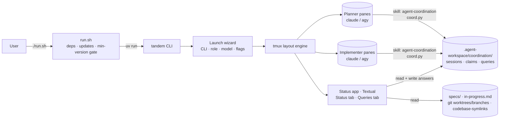

# Implementation Plan: tandem — Multi-Agent Terminal Workspace

## Branch Strategy
- **Working Branch**: `enhancement/agent-multiplexer` (both `agent-workspace-package` and this workspace repo for spec files)
- **Merge Target**: `trunk`
- **Observed Branch Pattern**: `enhancement/<short-description>` for improvements to the package
- **Branch Pattern Source**: Existing package branches (`enhancement/spec-planner-ui-mockups`, `enhancement/code-review-remediation-loop`, …) + user choice

## Repository Scope
- **Phase Directory**: `specs/p-001-agent-workspace-package`
- **Scope Type**: Single Repo
- **Primary Repository**: `agent-workspace-package`
- **Involved Repositories**:
  - `agent-workspace-package` (`codebase-symlinks/agent-workspace-package`): all code — `run.sh`, the `tandem/` Python CLI, new/updated skill templates, `templates/AGENTS.md`, README/CHANGELOG.
  - `agent-workspace` (this workspace): planning only (`specs/`, `knowledgebase/`). Not a code target.

## Phase Objectives
1. Add `run.sh` at the package root: detects dependencies and updates, asks before installing/updating, enforces a minimum-version gate, then launches `tandem`.
2. Build **tandem**, a Python CLI that launches multiple official AI CLIs (`claude`, `agy`) side-by-side in tmux as **planners** (left column) and **implementers** (right column), with a live status bar (Status + Queries tabs) and a self-documenting keyboard-first UI.
3. Add a file-based **coordination protocol** (sessions, task claims, queries) plus skill updates so every agent's work is tracked, visible in the status window, conflict-free, and never gated on an unanswered question.

## Decisions (confirmed with user, 2026-10-16)

| Topic | Decision |
|---|---|
| Name | `tandem` |
| Unified chat / load-balanced prompt routing | **Dropped.** Antigravity FAQ: "Wrapping `agy` inside third-party coding agents or applications … is not supported under consumer plans." Ban risk → dropped per user rule. |
| Terminal hosting | **Drive tmux.** CLIs run in real tmux panes. tandem only spawns them with documented flags; it never reads pane output or types into AI panes. |
| Answer delivery | **File-based queue.** No keystroke injection. Agents poll at checkpoints. |
| Code location | `agent-workspace-package/tandem/` + `agent-workspace-package/run.sh` |
| Platforms | macOS + Linux support in `run.sh` (brew / apt / dnf). **Test on macOS only for now.** |
| Models | **Ask at launch** — no hard-coded defaults. `agy` list from `agy models`; `claude` from aliases + free-text full ID. |
| Agent awareness | **Role-based.** Planners check current + planned implementations to avoid conflicting plans. Implementers use worktrees/branches and check running tasks/claims. All of it is visible in the status window. |
| "May crash" rule | Installed version below tandem's **min-version table** → re-prompt to update; decline → terminate. At/above minimum but outdated → soft prompt, decline proceeds. |
| Spec convention | Package's current `spec-planner` (`p-###-*`, `t-###.md`). |

## ToS Guardrails (non-negotiable, enforced by tests in t-006)
- tandem launches `claude` / `agy` exactly as a user would from a shell, using only their documented flags. No proxying, no OAuth/token handling, no API calls on their behalf.
- tandem **never** runs `tmux send-keys` or `tmux capture-pane` against an AI CLI pane. Those commands may target tandem's own panes only.
- No feature routes user prompts into any AI CLI. Coordination happens only because agents *choose* to read/write shared files through a skill.

## Architecture



- **run.sh** (bash): platform detection, dependency checks (`git`, `tmux`, `uv`, `claude`, `agy`), update checks, min-version gate (`tandem/min-versions.env`, a single source shared with tandem), `uv sync`, then `exec uv run tandem`.
- **tandem** (Python ≥ 3.11, managed by uv; Textual for UI; thin typed wrapper over the `tmux` CLI):
  - `adapters/`: one adapter per AI CLI that builds argv only (`claude --permission-mode auto --model … -n …`, `agy --model … [--dangerously-skip-permissions]`).
  - `layout/`: tmux session with two visible column panes, a status pane, and a hidden *stash* window. Per-column tabs work by swapping panes between a column and the stash.
  - `status/`: Textual app in the bottom pane with a **Status** tab (in-progress, per-phase progress, codebases, worktrees, branches, sessions/claims) and a **Queries** tab.
  - `coordination/`: typed reader/writer for the protocol files. The schema contract is shared with the skill's stdlib `coord.py`.
- **Coordination protocol**: under `<workspace>/.agent-workspace/coordination/` (absolute path exported as `TANDEM_COORD_DIR` to every pane so worktrees share one store):
  - `sessions/<id>.json`: cli, role, model, pane, cwd, branch, worktree, current task, heartbeat
  - `claims/<phase>--<task>.json`: atomic create-exclusive claim with branch, worktree, affected paths, heartbeat
  - `queries/<id>.md`: frontmatter `status: open|answered|acknowledged|withdrawn`, `asked_by`, `task`, `blocking_scope`, `answer`, `answered_via: tandem|cli`
- **Skills**: new `agent-coordination` skill (+ `scripts/coord.py`, stdlib only). `spec-planner` and `spec-implement` get coordination steps. The `templates/AGENTS.md` managed block gets a "Multi-Agent Coordination" principle.

## Existing Codebase Guide
- **Relevant Code Paths**:
  - `src/core/assets.js`: `listSkills()` auto-discovers `templates/skills/*`, so new skills ship without registry edits.
  - `templates/skills/workspace-init/scripts/link_codebases.py`, `templates/skills/skill-creator/scripts/*.py`: precedent for stdlib Python scripts inside skills (pattern for `coord.py`).
  - `templates/skills/spec-planner/SKILL.md`, `templates/skills/spec-implement/SKILL.md`: skills to extend.
  - `templates/AGENTS.md` (managed block lines 23–117), `templates/specs/in-progress.md`: shared rules and progress file that tandem reads.
  - `test/helpers.js` + `node --test`: existing test runner and tmp-dir/spawn pattern, reused for `run.sh` tests.
  - `package.json` `files`: must include `run.sh` and `tandem/` if they ship in the npm tarball.
- **Observed Patterns To Follow**:
  - ESM Node, no runtime deps; tests spawn the real binary in a tmp dir (`makeTmp`/`cleanup`).
  - Skills: YAML frontmatter `name`/`description`, numbered workflow, `## Mandates`.
  - CHANGELOG grouped by date with `### Base Skills` / `### Base Files` / `### CLI Package`.
  - Never overwrite user content; managed files are backed up to `.bak`.
- **Regression-Sensitive Areas**:
  - `init` / `update` / `doctor` behavior and the 22 existing tests (`npm test`).
  - `update` must keep backing up locally edited skills (`spec-planner`, `spec-implement`) before overwriting.
  - The AGENTS.md managed-block refresh must not touch user content above `<!-- managed:start -->`.
  - The Node-only runtime of `npx hydrokat/agent-workspace`. tandem must not become a dependency of `init`/`update`/`doctor`.

## Code Structure Diagram
```text
agent-workspace-package/
├── run.sh                                  # NEW  t-002 bootstrap entrypoint
├── package.json                            # MOD  t-009 files[] (+run.sh, +tandem/)
├── README.md / CHANGELOG.md                # MOD  t-009
├── test/
│   └── run-sh.test.js                      # NEW  t-002 (node --test, stubbed PATH)
├── tandem/                                 # NEW  Python project (uv)
│   ├── pyproject.toml / uv.lock            #      t-001
│   ├── min-versions.env                    #      t-001 shared by run.sh + tandem
│   ├── src/tandem/
│   │   ├── __main__.py / cli.py            #      t-001 entry, `tandem --version`
│   │   ├── config.py                       #      t-001 typed config, env access
│   │   ├── adapters/{base,claude,agy}.py   #      t-005 argv builders + model discovery
│   │   ├── wizard/                         #      t-005 launch + add-agent screens
│   │   ├── tmux/{client,layout,tabs,keys}.py #    t-006 layout engine, keymap, hints
│   │   ├── coordination/{schema,store}.py  #      t-003 protocol reader/writer
│   │   ├── sources/{specs,gitinfo,codebases}.py # t-007 status data sources
│   │   └── status/{app,status_tab,queries_tab}.py # t-007/t-008 Textual UI
│   └── tests/                              #      pytest per module
└── templates/
    ├── AGENTS.md                           # MOD  t-004 coordination principle
    ├── specs/in-progress.md                # MOD  t-004 session/claim fields
    └── skills/
        ├── agent-coordination/             # NEW  t-003
        │   ├── SKILL.md
        │   └── scripts/coord.py            #      stdlib only
        ├── spec-planner/SKILL.md           # MOD  t-004
        └── spec-implement/SKILL.md         # MOD  t-004
```

## UI Mockups

### Main layout (desktop terminal ≥ 120×35)
```text
┌─ PLANNERS ─ [1 claude·opus]  2 agy·argon ────────┬─ IMPLEMENTERS ─ [1 claude·sonnet]  2 agy·flash  3 + ─┐
│                                                   │                                                     │
│   (real claude TUI, untouched by tandem)          │   (real claude TUI, untouched by tandem)            │
│                                                   │   ⎇ enhancement/agent-multiplexer · wt: t-003       │
│                                                   │                                                     │
├─ [Status]  Queries (2) ───────────────────────────┴─────────────────────────────────────────────────────┤
│ In progress: t-003 claude·sonnet (impl #1) · t-005 agy·flash (impl #2)   ⚠ 1 stale claim                │
│ p-001-agent-workspace-package ████████░░░░ 4/10   p-002-multi ██░░░░░░░░ 1/6                            │
│ Codebases: agent-workspace-package   Worktrees: 3   Branches: enhancement/agent-multiplexer (+2)        │
├──────────────────────────────────────────────────────────────────────────────────────────────────────────┤
│ F1 Help  F2 New agent  F3/F4 Prev/Next tab  F5 Focus status  F6 Queries  F7/F8 Column  F10 Quit         │
└──────────────────────────────────────────────────────────────────────────────────────────────────────────┘
```
(Final keys are decided by the key-conflict audit in t-006. F-keys are the proposal because `claude`/`agy` bind many Ctrl/Alt chords.)

### Small terminal (< 100 cols) variant
```text
┌─ PLANNERS 1/2 ◂ ▸ ─────────────────┐   Columns stack vertically; the status pane
│  claude·opus                       │   collapses to one summary line. F7/F8
├─ IMPLEMENTERS 1/2 ◂ ▸ ─────────────┤   move focus between stacked columns.
│  claude·sonnet                     │
├─ Status · Queries (2) ─────────────┤
│ 4/10 · 2 running · 2 open queries  │
├────────────────────────────────────┤
│ F1 Help  F2 New  F3/F4 Tab  F10 ✕  │
└────────────────────────────────────┘
```

- **States Covered**: empty column ("No planners yet. Press F2 to add one"), launching, running, exited/crashed pane (keep pane, show exit code, `R` restart / `X` close), stale claim warning, no specs found, not a git repo, coordination dir missing, zero/open queries.
- **Interaction Notes**: keyboard-first; mouse via `tmux mouse on` (focus pane, scroll, resize) and native Textual clicks in the status app (tabs, query rows, buttons). Clicking a column's tab label on the border is a stretch goal (t-006). A persistent hint bar is always visible. F1 opens a help popup. A first-run tour explains the columns, status, and queries.
- **Accessibility Notes**: Works with no color (state shown as text/symbols, not just color). Respects `NO_COLOR`. Every action has a key and a visible hint. Focus is shown by a bold border plus a `▶` marker in the title.

## Timeline
- **t-001**: Scaffold the `tandem` Python project and min-version table (Done)
- **t-002**: `run.sh` bootstrap: dependency, update, and min-version gate (Done)
- **t-003**: Coordination protocol + `agent-coordination` skill + `coord.py` (Done)
- **t-004**: Coordination-aware `spec-planner`, `spec-implement`, AGENTS.md, in-progress template (Done)
- **t-005**: AI CLI adapters + launch / add-agent wizard (Done)
- **t-006**: tmux layout engine: columns, per-column tabs, keymap, hint bar, ToS guard (Done)
- **t-007**: Status tab: progress, sessions/claims, codebases, worktrees, branches (Done)
- **t-008**: Queries tab: answer queue with live sync (Done)
- **t-009**: Docs, packaging, and knowledgebase (Done)
- **t-010**: Delivery: Commit, PR, Review, CI, Merge (Done)
- **t-011**: Save AI state: resume each agent's conversation and recover from crashes (In Review, PR #13)

## Tasks
- [x] t-001: [New Feature] Scaffold the `tandem` Python project and min-version table
- [x] t-002: [New Feature] `run.sh` bootstrap: dependency, update, and min-version gate
- [x] t-003: [New Feature] Coordination protocol + `agent-coordination` skill + `coord.py`
- [x] t-004: [Enhancement] Coordination-aware `spec-planner`, `spec-implement`, AGENTS.md, in-progress template
- [x] t-005: [New Feature] AI CLI adapters + launch / add-agent wizard
- [x] t-006: [New Feature] tmux layout engine: columns, per-column tabs, keymap, hint bar, ToS guard
- [x] t-007: [New Feature] Status tab: progress, sessions/claims, codebases, worktrees, branches
- [x] t-008: [New Feature] Queries tab: answer queue with live sync
- [x] t-009: [Enhancement] Docs, packaging, and knowledgebase
- [x] t-010: Delivery: Commit, PR, Review, CI, Merge
- [ ] t-011: [Enhancement] Save AI state: resume each agent's conversation and recover from crashes (PR #13, awaiting merge)

## Dependency Order
`t-001 → t-002`; `t-001 → t-003 → t-004`; `t-001 → t-005 → t-006`; `t-003 + t-006 → t-007 → t-008`; all → `t-009 → t-010`.
`t-002`, `t-003`, and `t-005` can run in parallel after `t-001`.

## Open Questions (do not block planning; resolve before the named task starts)
1. **(t-002) Declining an AI CLI install.** Read literally, "if user does not want to install, terminate" means declining `agy` would terminate even for a claude-only user. Planned default: follow the literal rule. Alternative: allow the decline as long as at least one AI CLI is installed.
2. **(t-002) `agy` install/update-check commands.** `agy update` exists, but there is no confirmed check-only mode or official install one-liner. t-002 must verify these from official docs before coding. If no check-only command exists, report "latest unknown" and skip the soft prompt.
3. **(t-009) npx entry.** Should `npx hydrokat/agent-workspace run` call `run.sh`? Planned default: no. `run.sh` is invoked directly, and tandem stays out of the Node CLI.
