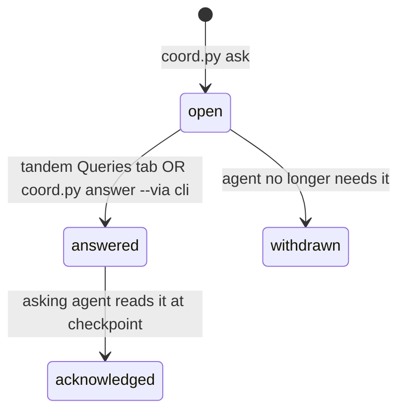

# t-003: Coordination protocol + `agent-coordination` skill + `coord.py`

## Description
Define the file-based protocol that lets every AI CLI session (inside tandem or not) register itself, claim work atomically, report progress, and ask non-blocking questions. Ship it as a new workspace skill `templates/skills/agent-coordination/` with a stdlib-only `scripts/coord.py`. tandem's `coordination/` module (read/write side) implements the same schema, and contract tests keep the two in sync.

## Requirement Classification
- **Type**: New Feature
- **Rationale**: Today only `specs/in-progress.md` exists. It is free text, not machine-readable, and has no claims or queries.
- **Regression Risk**: Medium. A new managed skill is copied into every workspace on `init`/`update`, so `doctor`/`update` tests must still pass with one more skill.

## Knowledge References
- [x] Relevant `knowledgebase/` docs/patterns identified and reviewed
  - `knowledgebase/best-practices/operating_principles.md`
  - `AGENTS.md` §4 Documentation Sync, §7 Branch Protection, §8 Concurrent Agent Awareness
  - `knowledgebase/guidelines/security.md`, `knowledgebase/best-practices/malicious-payloads.md` (query text is user/agent-supplied)

## Existing Codebase Guide
- [x] Existing implementation inspected before coding
  - **Relevant Code Paths**: `src/core/assets.js#listSkills` (auto-discovery), `templates/skills/workspace-init/scripts/link_codebases.py` (stdlib script style), `templates/skills/*/agents/openai.yaml` (Codex metadata per skill)
  - **Patterns To Reuse**: SKILL.md frontmatter + numbered workflow + `## Mandates`; `agents/openai.yaml` beside it

## Code Structure Diagram
```text
templates/skills/agent-coordination/
├── SKILL.md
├── agents/openai.yaml
├── references/protocol.md         # schema + state machines (canonical)
└── scripts/coord.py               # stdlib only, python3 >= 3.9

<workspace>/.agent-workspace/coordination/    # runtime; TANDEM_COORD_DIR overrides
├── sessions/<session-id>.json
├── claims/<phase>--<task>.json
└── queries/<query-id>.md

tandem/src/tandem/coordination/{schema,store}.py   # same schema, typed
tandem/tests/test_contract_coord.py                # runs coord.py, parses with tandem
```



## UI Mockups
N/A: CLI/protocol only. Rendering lives in t-007/t-008.

## Objectives
- [x] `coord.py` subcommands (JSON output, non-zero exit on conflict):
  - `whoami`: prints role/cli/session from env (`TANDEM_SESSION_ID`, `TANDEM_ROLE`, `TANDEM_CLI`). Outside tandem, it generates and registers a session.
  - `register | heartbeat | unregister`
  - `claim <phase> <task> --branch --worktree --paths …` (atomic `O_CREAT|O_EXCL`), `release`, `claims [--stale]`
  - `ask --task --blocking-scope "<what is blocked>" "<question>" [--option …]`, `answers [--mine]`, `ack <id>`, `answer <id> "<text>" --via cli|tandem`, `withdraw <id>`
  - `overview`: sessions + claims + open queries in one call (what planners read before planning)
- [x] Atomic writes (write temp + `os.replace`). Lock-free reads. Heartbeat TTL (default 10 min) → `stale` flag. Stale claims are never auto-stolen; taking one requires a query to the user.
- [x] Coordination root resolution: `TANDEM_COORD_DIR` → else the workspace root found by walking up for `.agent-workspace/manifest.json` from the **main** worktree (`git rev-parse --git-common-dir`), so agents in worktrees share one store.
- [x] Input hardening: ids are `[a-z0-9-]{1,64}`; phase/task validated against `p-\d{3}-[a-z0-9-]+` / `t-\d{3}`; path traversal rejected; question/answer text stored as data (YAML-safe quoting), size-capped.
- [x] SKILL.md: when to call each command, the checkpoint rule ("check `answers --mine` after every task milestone"), and the non-blocking rule ("after `ask`, continue with work outside `blocking_scope`; if nothing is left, say so in the CLI and wait").
- [x] Add `.agent-workspace/coordination/` to the workspace `.gitignore` written by `init` (runtime state, not history). Verify `init`/`update` behavior in tests.

## Branches
- **Working Branch**: `enhancement/agent-multiplexer`
- **Merge Target**: `trunk`

## Testing (TDD)
- [x] Unit tests written before implementation: concurrent claim race (two processes, exactly one wins), stale detection, worktree root resolution, malicious ids/paths/text, answered-elsewhere flow
- [x] Unit tests passing (`uv run pytest` + skill script tests)
- [x] Regression tests or validation added for affected existing behavior (`init`/`update`/`doctor` tests with the new skill)
- [x] Existing relevant test suites passing

## Security
- [x] Security audited (path traversal, YAML/frontmatter injection, symlink attacks in the coordination dir, file permissions 0600/0700)
- [x] Security audit passed

## Code Quality
- [x] Implementation follows existing codebase patterns
- [x] No unnecessary comments added; code is self-documenting where practical
- [x] Documentation-generator comments are present only where useful

## Knowledge Updates
- [x] `knowledgebase/business-flows/` entry for the coordination flow (register → claim → work → ask → checkpoint → release) in the package's KB templates, or N/A with reason

## Agent Assignment
- **Primary Agent**: senior-backend-dev (role acted by main session)
- **Supporting Agents**: security-auditor (self-audit)
- **Skills**: spec-implement, agent-coordination

## Implementation Notes
Changed files (`agent-workspace-package`):
- NEW `templates/skills/agent-coordination/{SKILL.md,agents/openai.yaml,references/protocol.md,scripts/coord.py}`
- NEW `tandem/src/tandem/coordination/{__init__,schema,store}.py`
- NEW `tandem/tests/{test_coord_script,test_contract_coord}.py`

Decisions:
- Query files are frontmatter-only; every value is a one-line JSON scalar/array. Question/answer text can never inject fields or fences, and control/escape characters are stripped.
- Claims use `os.link` of a fully written temp file: exclusive and never half-written. An 8-process race test proves exactly one winner.
- Query state transitions take an `fcntl` lock; `answer` refuses non-`open` queries (exit 1) so a CLI answer is never overwritten by tandem or vice versa.
- Store dirs are `0700`/files `0600`; symlinked store directories are refused (exit 2); a `.gitignore` containing `*` is written inside the coordination dir.
- **Deviation:** the objective said to add `.agent-workspace/coordination/` to the workspace `.gitignore` written by `init`. `init` does not write a workspace `.gitignore`, so the coordination dir ignores itself instead; no `init` change was needed.
- Exit codes: 0 ok, 1 conflict, 2 invalid input (argparse errors also exit 2).
- tandem's `CoordStore` is a tolerant reader (garbage files skipped) plus an `answer()` writer sharing the same lock and format; the contract tests run `coord.py` and parse the result with tandem.

## Validation
- Tests first: written before `coord.py` existed.
- `uv run pytest`: 61 passed (23 script tests incl. race, stale, traversal, injection, worktree root; 5 contract tests).
- `uv run mypy` strict: clean.
- `npm test`: 24 passed (new skill ships through `listSkills()` with no registry change).

## Security Review
Self-audit: path traversal (ids regex-validated, no user path joins), frontmatter injection (JSON-encoded values, tested), symlink attack on store dirs (refused, tested), permissions (0700/0600, tested), no `shell=True` anywhere, git called with argv and a timeout. Residual: same-user local processes can still write the store by design (no auth between agents of one user).

## Knowledgebase Updates
- [x] Business-flow entry for coordination: written in t-009 (`templates/knowledgebase/business-flows/multi-agent-coordination.md`).

## Status
- [x] Done
